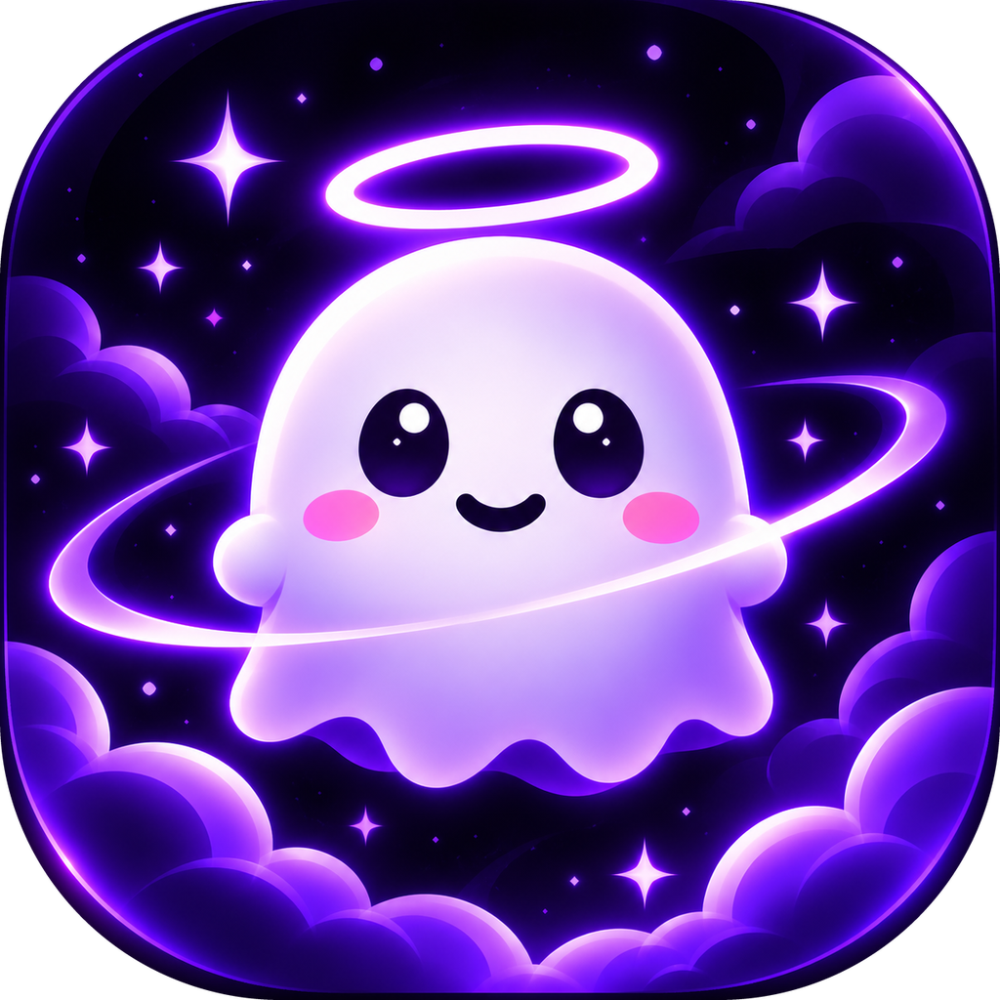
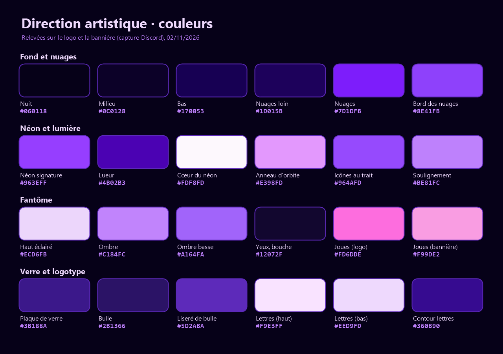

# Boofer art direction

Last updated: 2026-11-02.

Sources: the logo (`assets/icon.png`, 1024 px; the original is 1254 px) and the author's Discord banner (seen on an 825 × 465 px screenshot). The colors were picked from the screenshot, then checked against the original logo: they match within a few units.

## The mood

Cute, nocturnal, neon, magical, reassuring. A soft, smiling little ghost keeps watch in a purple night full of clouds and stars. The halo says "I protect you", the orbit ring "I circle around your work". Neon and glass give the tech touch, but everything stays round, shiny and soft: no aggressive edge, no red, nothing scary.

## The name

Boofer, with a single f, like the repository and the banner. The app identifier `dev.booffer.desktop` and a few storage keys keep the old spelling so settings and history are not lost.

## The colors

| Role | Color |
|---|---|
| Background, darkest (top, center) | `#060118` |
| Background, middle | `#0C0128` |
| Background, bottom (where the clouds rise) | `#170053` |
| Corners, outside the frame | `#08000F` |
| Distant clouds | `#1D015B` |
| Clouds, body | `#7D1DFB` |
| Clouds, lit edge | `#8E41FB` (tips `#BD55FF`) |
| Neon, the signature color (halo, outlines, strokes) | `#963EFF` |
| Neon, glow fading into the background | `#4B02B3` |
| Core of neon strokes, sparkles | `#FDF8FD` |
| Orbit ring | `#E398FD` (edges `#BF57FC`) |
| Ghost, lit top | `#ECD6FB` (highlight `#FEFEFE`) |
| Ghost, shaded side | `#C184FC` then `#A164FA` |
| Eyes and mouth (never pure black) | `#12072F` (pupil core `#02001F`) |
| Eye highlight | `#FEFDFE` |
| Cheeks | `#FD6DDE` (logo), `#F99DE2` (banner, softer) |
| Logotype glass plate | `#3B188A` |
| Icon bubbles | `#160B35` to `#2B1366`, outline `#5D2ABA` |
| Logotype, fill | `#F9E3FF` at the top, `#EED9FD` at the bottom |
| Logotype, outline | `#360B90` |
| Logotype underline | `#BE81FC` |
| Line icons | `#964AFD` |

Neon purple `#963EFF` and pinkish white `#FDF8FD` are reserved for what must shine. No other bright color (green, red, yellow) in the scenery; the only exception: the app ghost's state colors when the app is shown as it is (green when a task is done, yellow for a request, pink for "Stop!").

## Gradients

- Background: radial from `#060118` (top, center) to `#170053` (bottom), near-black corners.
- Ghost body: light at the top left (`#FEFEFE` to `#ECD6FB`), purple shadow at the bottom right (`#C184FC` to `#A164FA`).
- Orbit ring: `#BF57FC` on the edges, `#E498FE` in the middle of the stroke, thinning into a comet trail.
- Clouds: stacked balls from `#1D015B` (back) to `#7D1DFB` (front), light outline on the lit edge.

## Effects

- Neon glow: an almost white core surrounded by a saturated purple fading into the background. In CSS: a three-layer `box-shadow` or `drop-shadow`, for example `0 0 4px #FDF8FD, 0 0 12px #A813FB, 0 0 32px #4B02B3`. The glow only exists on dark.
- Halo: flat ellipse above the head, white core, strong purple glow. It floats with a slight delay behind the head.
- Orbit ring (logo only): tilted about 15 degrees, goes behind the ghost on the left and in front on the right.
- Glass plates: dark translucent panels, thin neon outline, light diagonal reflection in a corner. Icon bubbles have a small speech-bubble tail.
- Four-pointed sparkles: pinkish white, three sizes, in a sparse constellation.
- Stardust: small round purple dots of 2 to 4 px, slightly blurred.
- Clouds: round cartoon balls, in two layers, always framing the bottom.
- Ledge (banner): a dark rounded ledge the ghost peeks over, paws resting on it.

## The character

The brand ghost (logo, banner) is a very round marshmallow: head and body are one, small round arms, a hem with four or five waves. Two big vertical oval eyes in night purple with a big highlight, a small arc smile, oval pink cheeks under the eyes, on the outside. Soft and shiny rendering, lit from the top left, no outline, with a purple glow around the body and a neon halo above the head.

Since v0.3.6, the app ghost (`src/ui/mascot.js`, `src/style.css`) follows the logo as a vector drawing: big round eyes with one highlight, pink cheeks, an always-present neon purple halo (hidden under a hat), a purple glow around the body. The halo turns golden at level 5. Its colors, Classic skin:

| Role | Color |
|---|---|
| Body, top | `#FFFFFF` |
| Body, bottom | `#D9C8FF` |
| Eyes and mouth | `#1E1533` |
| Cheeks | `#FF8CC6` |
| Halo | stroke `#D8CCFF`, glow `#A78BFA` then `#8B5CF6` |
| Golden halo (level 5) | stroke `#FDE68A`, glow `#FACC15` then `#F59E0B` |
| Body glow | `rgb(167 139 250 / 0.55)` |

Remaining differences between the logo and the app, normal between an illustration and a sprite: the logo has two highlights per eye and a glossy rendering; the app one highlight and a simple gradient. The cheeks are softer on the banner than on the logo.

## Typography

- The logotype is not a font: it is hand-drawn lettering, very bold, rounded, slanted about 8 to 10 degrees, light lilac with a deep purple outline, on a glass plate. It is reused as is from the original file: never distorted, recolored or retyped with a font.
- Short titles (1 to 4 words): Grandstander Black Italic, the closest match (Google Fonts, OFL license). Alternatives: Chewy, or Fredoka Bold slanted 8 degrees for more readability.
- Captions and body text: Nunito (Bold for captions), light lilac `#EED9FD` or white on the night background. Never long text in neon purple.
- App screenshots: keep the system font (Segoe UI) as it is.

## Icons

Line icons with rounded ends, an even thick stroke, neon purple `#964AFD` with a slight glow, centered in dark glass bubbles. The banner's ones: code chevrons, shield with a check mark, laptop. To complete in the same style: clock, progress bar, raised hand, lightning, small ghosts, star. A free base that fits: Lucide or Phosphor.

## Composition

- Logo: rounded square like an app icon (radius about 18% of the side). Ghost centered, a bit above the middle, about 55% of the width; halo in the top quarter; ring diagonally across the middle; clouds in the bottom quarter.
- Banner: the ghost peeking over the ledge on the left, the logotype on its plate on the right. The character's gaze leads to the name.
- Rules: the character looks toward the text or the action; a safety margin of about 8% with no text; a single very bright spot per image (the halo or the logotype); three bubbles at most at a time.
- Vertical (9:16): halo and ghost in the top two thirds, text below, clouds at the bottom.

## Motion

Taken from the app's animations (`src/style.css`), so the brand and the app move the same way:

- The ghost floats all the time: 6 px up and down, in 3.2 s when idle. The harder it works, the shorter the cycle (1.8 s thinking, 1.2 s using a tool).
- Squash and stretch, never a uniform scale alone: it squashes before a jump, stretches in the air, settles when landing. The victory jump is 26 px in 0.9 s.
- Appearances have a small elastic pop: `cubic-bezier(0.3, 1.8, 0.5, 1)` in 0.25 to 0.3 s.
- Loops use `ease-in-out`, one-time appearances `ease-out`.
- Offsets rather than everything at once: sparkles at 0, 90, 160 and 60 ms; the halo follows the head with a delay.
- Brand-specific: the orbit ring turns slowly, the sparkles twinkle one after the other, the clouds glide in slow parallax, the glow pulses gently (2 to 3 s).
- Small, cute amplitudes: everything stays soft, nothing shakes hard.

## Other brands

- The Discord logos on the banner belong to the Discord banner only: they are not part of the art direction and go in no video.
- No other brand logo (Claude, Anthropic, OpenAI, Google). To say what Boofer works with, write the names as text (Claude Code, Codex, Gemini), without suggesting a partnership, with the note "Independent project, not affiliated with Anthropic, OpenAI or Google" whenever one of these names appears.

## Files

- The logo is in the repository: `assets/icon.png` (1024 px), enough for a 1080p video.
- The banner isn't: we would need its original version, without the Discord logos.
- To animate the halo, the ring or the clouds separately, we would need the logo in separate layers (ghost, halo, ring, clouds, sparkles), as transparent PNG or SVG. Without them, the logo is animated as one block, or the scenery is redrawn in vector around the app ghost.
