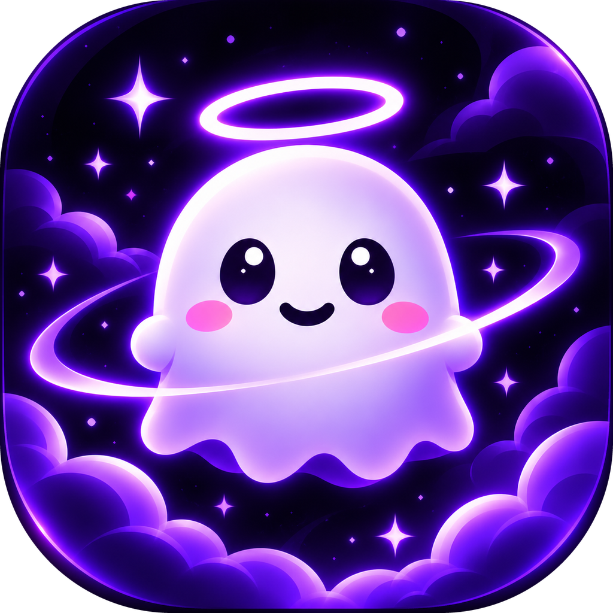
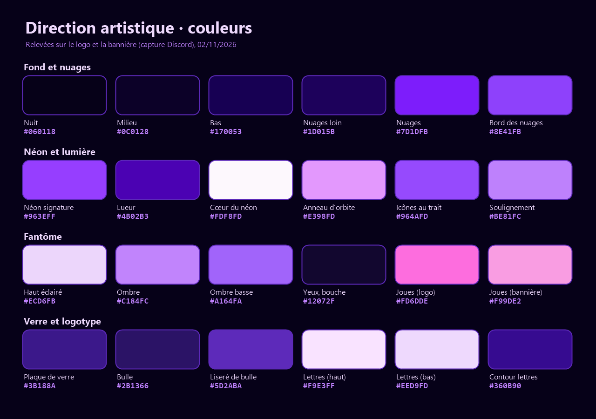

# Direction artistique de Boofer

Dernière mise à jour : 02/11/2026.

Sources : le logo (`assets/icon.png`, 1024 px ; l'original fait 1254 px) et la bannière Discord de l'auteur (vue sur une capture de 825 × 465 px). Les couleurs ont été relevées sur la capture, puis vérifiées sur le logo d'origine : elles concordent à quelques unités près.

## L'ambiance

Mignon, nocturne, néon, magique, rassurant. Un petit fantôme doux et souriant veille dans une nuit violette pleine de nuages et d'étoiles. Le halo dit « je te protège », l'anneau d'orbite « je tourne autour de ton travail ». Le néon et le verre donnent la touche technique, mais tout reste rond, brillant et doux : pas d'arête agressive, pas de rouge, rien qui fasse peur.

## Le nom

Boofer, avec un seul f, comme le dépôt et la bannière. Le code dit encore « Booffer » par endroits (README, `productName`, identifiant `dev.booffer.desktop`) : l'auteur le corrige.

## Les couleurs

| Rôle | Couleur |
|---|---|
| Fond, le plus sombre (haut, centre) | `#060118` |
| Fond, milieu | `#0C0128` |
| Fond, bas (là où montent les nuages) | `#170053` |
| Coins, hors du cadre | `#08000F` |
| Nuages lointains | `#1D015B` |
| Nuages, corps | `#7D1DFB` |
| Nuages, bord éclairé | `#8E41FB` (pointes `#BD55FF`) |
| Néon, la couleur signature (halo, liserés, contours) | `#963EFF` |
| Néon, lueur qui s'éteint dans le fond | `#4B02B3` |
| Cœur des traits néon, étincelles | `#FDF8FD` |
| Anneau d'orbite | `#E398FD` (bords `#BF57FC`) |
| Fantôme, haut éclairé | `#ECD6FB` (reflet `#FEFEFE`) |
| Fantôme, côté ombré | `#C184FC` puis `#A164FA` |
| Yeux et bouche (jamais de noir pur) | `#12072F` (cœur des pupilles `#02001F`) |
| Reflet des yeux | `#FEFDFE` |
| Joues | `#FD6DDE` (logo), `#F99DE2` (bannière, plus doux) |
| Plaque de verre du logotype | `#3B188A` |
| Bulles d'icônes | `#160B35` à `#2B1366`, liseré `#5D2ABA` |
| Logotype, remplissage | `#F9E3FF` en haut, `#EED9FD` en bas |
| Logotype, contour | `#360B90` |
| Soulignement du logotype | `#BE81FC` |
| Icônes au trait | `#964AFD` |

Le violet néon `#963EFF` et le blanc rosé `#FDF8FD` sont réservés à ce qui doit briller. Pas d'autre couleur vive (vert, rouge, jaune) dans le décor ; seule exception : les couleurs d'état du fantôme de l'application quand on la montre telle qu'elle est (vert en fin de tâche, jaune en demande, rose au « Stop ! »).

## Les dégradés

- Fond : radial de `#060118` (haut, centre) vers `#170053` (bas), coins presque noirs.
- Corps du fantôme : lumière en haut à gauche (`#FEFEFE` à `#ECD6FB`), ombre violette en bas à droite (`#C184FC` à `#A164FA`).
- Anneau d'orbite : `#BF57FC` sur les bords, `#E498FE` au centre du trait, qui s'amincit en traînée de comète.
- Nuages : boules empilées de `#1D015B` (fond) à `#7D1DFB` (devant), liseré clair sur le bord éclairé.

## Les effets

- Lueur néon : un cœur presque blanc entouré d'un violet saturé qui s'éteint dans le fond. En CSS : `box-shadow` ou `drop-shadow` en trois couches, par exemple `0 0 4px #FDF8FD, 0 0 12px #A813FB, 0 0 32px #4B02B3`. La lueur n'existe que sur du sombre.
- Halo : ellipse plate au-dessus de la tête, cœur blanc, forte lueur violette. Il flotte avec un temps de retard sur la tête.
- Anneau d'orbite (logo seulement) : incliné d'environ 15 degrés, passe derrière le fantôme à gauche et devant à droite.
- Plaques de verre : panneaux sombres translucides, liseré néon fin, reflet clair en diagonale dans un coin. Les bulles d'icônes ont une petite queue de bulle de dialogue.
- Étincelles à quatre branches : blanc rosé, trois tailles, en constellation clairsemée.
- Poussière d'étoiles : petits points ronds violets de 2 à 4 px, un peu flous.
- Nuages : boules rondes de dessin animé, en deux plans, qui encadrent toujours le bas.
- Rebord (bannière) : un rebord sombre et arrondi derrière lequel le fantôme regarde, les pattes posées dessus.

## Le personnage

Le fantôme de la marque (logo, bannière) est une guimauve très ronde : tête et corps ne font qu'un, petits bras ronds, ourlet à quatre ou cinq vagues. Deux grands yeux ovales verticaux violet nuit avec un gros reflet, un petit sourire en arc, des joues roses ovales sous les yeux, à l'extérieur. Rendu doux et brillant, éclairé en haut à gauche, sans contour, avec une lueur violette autour du corps et un halo néon au-dessus de la tête.

Depuis la v0.3.6, le fantôme de l'application (`src/ui/mascot.js`, `src/style.css`) reprend le logo en dessin vectoriel : grands yeux ronds à un reflet, joues roses, halo violet néon toujours présent (caché sous un chapeau), lueur violette autour du corps. Le halo devient doré au niveau 5. Ses couleurs, skin Classique :

| Rôle | Couleur |
|---|---|
| Corps, haut | `#FFFFFF` |
| Corps, bas | `#D9C8FF` |
| Yeux et bouche | `#1E1533` |
| Joues | `#FF8CC6` |
| Halo | trait `#D8CCFF`, lueur `#A78BFA` puis `#8B5CF6` |
| Halo doré (niveau 5) | trait `#FDE68A`, lueur `#FACC15` puis `#F59E0B` |
| Lueur du corps | `rgb(167 139 250 / 0.55)` |

Différences qui restent entre le logo et l'application, normales entre une illustration et un sprite : le logo a deux reflets par œil et un rendu brillant ; l'application un reflet et un dégradé simple. Les joues sont plus douces sur la bannière que sur le logo.

## La typographie

- Le logotype n'est pas une police : c'est un lettrage dessiné, très gras, arrondi, penché d'environ 8 à 10 degrés, lilas clair avec un contour violet profond, sur une plaque de verre. Il se reprend tel quel depuis le fichier d'origine : ni déformé, ni recoloré, ni réécrit avec une police.
- Titres courts (1 à 4 mots) : Grandstander Black Italic, la plus proche (Google Fonts, licence OFL). Autres choix : Chewy, ou Fredoka Bold penchée de 8 degrés si on veut plus lisible.
- Légendes et textes : Nunito (Bold pour les légendes), lilas clair `#EED9FD` ou blanc sur le fond nuit. Jamais de texte long en violet néon.
- Captures de l'application : garder la police système (Segoe UI) telle quelle.

## Les icônes

Icônes au trait aux bouts arrondis, trait épais régulier, violet néon `#964AFD` avec une légère lueur, au centre de bulles de verre sombre. Celles de la bannière : chevrons de code, bouclier avec coche, ordinateur portable. Pour compléter dans le même style : horloge, barre de progression, main levée, éclair, petits fantômes, étoile. Base libre qui colle : Lucide ou Phosphor.

## La composition

- Logo : carré arrondi type icône d'application (rayon d'environ 18 % du côté). Fantôme centré, un peu au-dessus du milieu, sur environ 55 % de la largeur ; halo dans le quart du haut ; anneau en diagonale au milieu ; nuages dans le quart du bas.
- Bannière : le fantôme qui regarde par-dessus le rebord à gauche, le logotype sur sa plaque à droite. Le regard du personnage mène au nom.
- Règles : le personnage regarde vers le texte ou l'action ; marge de sécurité d'environ 8 % sans texte ; un seul point très lumineux par image (le halo ou le logotype) ; trois bulles au plus à la fois.
- Vertical (9:16) : halo et fantôme dans les deux tiers du haut, texte en dessous, nuages en bas.

## Le mouvement

Repris des animations de l'application (`src/style.css`), pour que la marque et l'application bougent pareil :

- Le fantôme flotte en permanence : 6 px de haut en bas, en 3,2 s au repos. Plus il travaille, plus le cycle est court (1,8 s en réflexion, 1,2 s quand il utilise un outil).
- Écrasement et étirement, jamais une mise à l'échelle uniforme seule : il s'écrase avant un saut, s'étire en l'air, se tasse en retombant. Le saut de fin fait 26 px en 0,9 s.
- Les apparitions font un petit pop élastique : `cubic-bezier(0.3, 1.8, 0.5, 1)` en 0,25 à 0,3 s.
- Les boucles sont en `ease-in-out`, les apparitions uniques en `ease-out`.
- Décalages plutôt que tout en même temps : étincelles à 0, 90, 160 et 60 ms ; le halo suit la tête avec un temps de retard.
- Propres à la marque : l'anneau d'orbite tourne lentement, les étincelles scintillent l'une après l'autre, les nuages glissent en parallaxe lente, la lueur pulse doucement (2 à 3 s).
- Amplitudes petites et mignonnes : tout reste doux, rien ne secoue fort.

## Les marques des autres

- Les logos Discord de la bannière appartiennent à la bannière Discord seulement : ils ne font pas partie de la DA et ne vont dans aucune vidéo.
- Aucun autre logo de marque (Claude, Anthropic, OpenAI, Google). Pour dire avec quoi Booffer fonctionne, écrire les noms en texte (Claude Code, Codex, Gemini), sans laisser croire à un partenariat, avec la mention « Projet indépendant, non affilié à Anthropic, OpenAI ou Google » dès qu'un de ces noms apparaît.

## Les fichiers

- Le logo est dans le dépôt : `assets/icon.png` (1024 px), assez pour une vidéo en 1080p.
- La bannière n'y est pas : il faudrait sa version d'origine, sans les logos Discord.
- Pour animer le halo, l'anneau ou les nuages séparément, il faudrait le logo en calques séparés (fantôme, halo, anneau, nuages, étincelles), en PNG transparent ou en SVG. Sans eux, on anime le logo d'un bloc, ou on refait le décor en vectoriel autour du fantôme de l'application.
